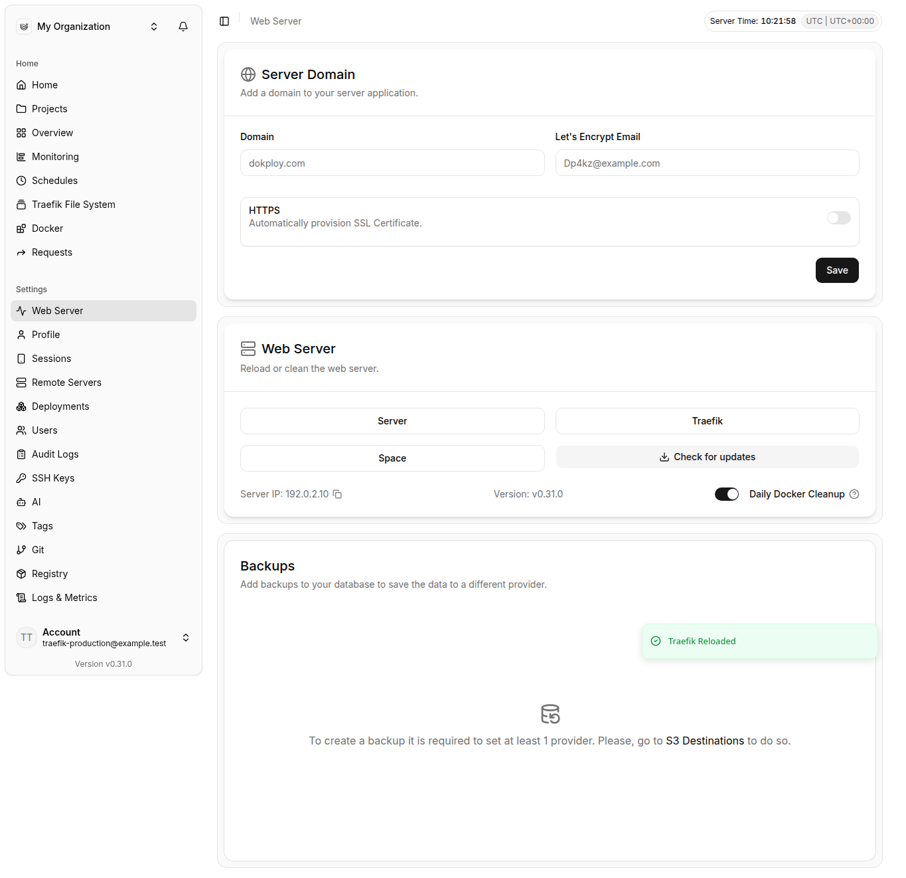
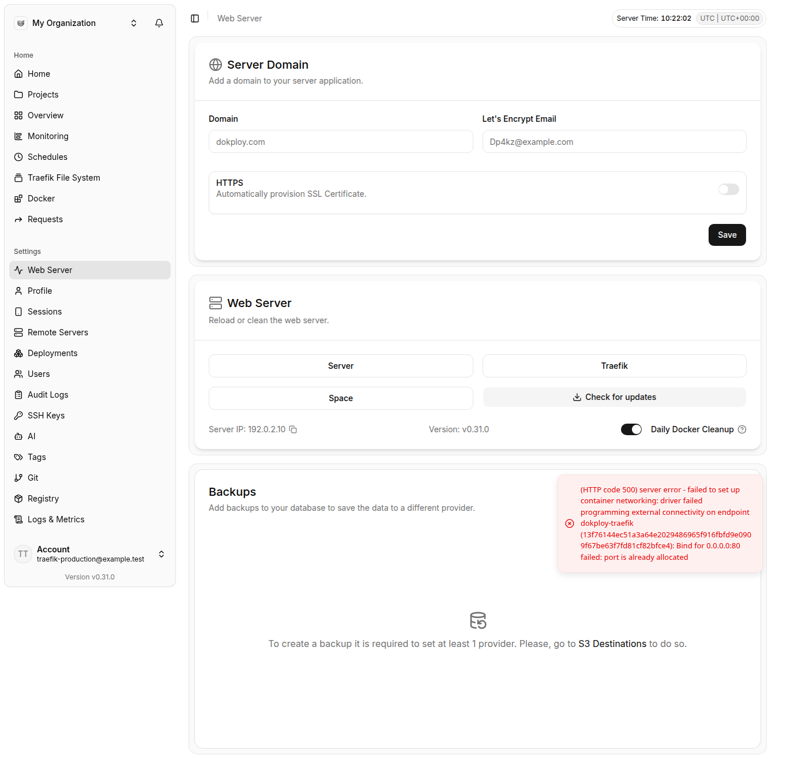

# Traefik recovery verification

Implementation: [6e7029b87](https://github.com/brahimrizq/dokploy/commit/6e7029b87). Issue: [Dokploy/dokploy#5960](https://github.com/Dokploy/dokploy/issues/5960).

The production fixture uses Node 24.22.1, the full optimized Dokploy build, PostgreSQL 18.6, Traefik 3.7.16 and Docker 29.9.3. Dokploy runs as a real Swarm service inside a disposable Docker-in-Docker engine. Only the nested Swarm is used for these tests.

All ten production checks and four production browser checks passed. All three daemon crash/restart cycles restored the panel, the overlay application and eight isolated Compose connections without manual Traefik recovery. The reported overlay boot failure was observed in two of those cycles. Startup recovery, the real one-minute timer, container deletion, and Reload through the proxy being restarted also passed.

The separate development checks cover real Docker recreation after an injected stale-IP start error. They verify configuration and nine network attachments are retained. This error injection is recorded in the results; it is not claimed as a naturally occurring IP conflict.

The broader regression run passed 1,685 tests with four skipped. The unrelated real application deployment suite was excluded. The final affected suites passed all 178 tests. Workspace type checks, changed-file Biome checks, the full production app build and documentation build passed.

These are daemon crashes inside Docker, not full VM reboots. Remote recovery over SSH was not live tested. Test credentials were generated privately and removed after testing. Screenshots use a test account and a documentation IP.

## Browser evidence

